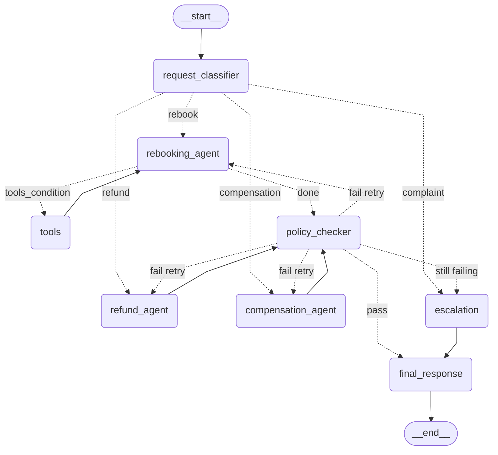

# Flight Disruption Rebooking Assistant

A LangGraph multi-agent assistant that handles airline disruption requests: classify the ask, propose a solution (rebook / refund / compensation), enforce airline policy with a retry cycle, escalate when needed, and reply to the passenger. Conversations are persisted with a checkpointer so follow-up messages reuse booking context.

## LangGraph concepts used

| Concept | Where |
| --- | --- |
| `StateGraph` + typed state | `RebookingState` in `src/state.py` |
| Nodes and edges | Eight nodes in `src/graph.py` |
| Conditional edges | Classifier routing; policy pass/fail/retry; `tools_condition` for the tool loop |
| Tool-calling loop | `rebooking_agent` ⇄ `ToolNode` (`tools`) |
| Cycle + counter | `policy_checker` → same agent while `retry_count ≤ 2`, else escalation |
| Checkpointer + threads | `MemorySaver` + `thread_id` per passenger |

## Graph diagram



Regenerate from the live graph:

```bash
python main.py --diagram
```

Output is written to `docs/graph.mmd`.

## Node responsibilities

1. **request_classifier** — Structured LLM output extracts `intent` (`rebook` / `refund` / `compensation` / `complaint`) and passenger `constraints`, then sets `active_agent`.
2. **rebooking_agent** — LLM with `get_booking` + `search_flights` bound; loops with the ToolNode until it proposes one replacement flight.
3. **tools** — LangGraph `ToolNode` that executes rebooking tool calls.
4. **refund_agent** — Reads booking + fare rules and proposes `refund_amount`.
5. **compensation_agent** — Reads delay / cancellation details and proposes `compensation_amount`.
6. **policy_checker** — Plain Python (no LLM). Validates the proposal; on failure stores the reason and increments `retry_count`.
7. **escalation** — Writes a short human-agent handover note (complaints, or policy still failing after retries).
8. **final_response** — Passenger-facing reply with outcome, next steps, and whether a human will follow up.

## State design

`RebookingState` (`src/state.py`) is a `TypedDict`. Conversation history uses LangGraph’s `add_messages` reducer. Fields:

| Field | Owner |
| --- | --- |
| `request_id`, `booking_ref` | Intake |
| `messages` | All nodes (reducer) |
| `intent`, `constraints`, `active_agent` | Classifier |
| `booking` | Specialists / policy hydrate |
| `proposed_solution` | Specialist agents |
| `policy_passed`, `policy_failure_reason`, `retry_count` | Policy checker |
| `escalated`, `escalation_note` | Escalation |
| `final_response` | Final response |

## Routing logic

Conditional edges (not hidden inside nodes):

1. **After classifier** (`route_after_classifier`) — complaint → escalation; else the matching specialist.
2. **After rebooking** (`tools_condition`) — tool calls → `tools` → back to rebooking; otherwise → policy checker.
3. **After policy** (`route_after_policy`) — pass → final response; fail with `retry_count ≤ 2` → same `active_agent`; fail with `retry_count > 2` → escalation.

## Policy rules

| Request | Rule |
| --- | --- |
| Rebook | Same cabin or lower; departs within 48 hours of original; connection ≥ 60 minutes |
| Refund | Airline cancelled/disrupted → full fare. Passenger choice on non-refundable → taxes only |
| Compensation | &lt;3h → $0; 3–6h → $200; &gt;6h or cancelled → $400 |

Implemented in `src/policy.py`. Failure reasons are written to state so the next agent attempt can correct course. After the first failure plus two retries (three failed checks), the graph escalates and always terminates.

## Tools (mock, deterministic)

| Tool | Used by | Returns |
| --- | --- | --- |
| `get_booking(booking_ref)` | All specialists | Passenger, route, cabin, fare, disruption |
| `search_flights(origin, destination, date)` | Rebooking | Fixed flight list; CDG→JFK is **business-only** so the retry loop can be tested |
| `get_fare_rules(fare_type)` | Refund | Refundable flag + tax guidance |

Catalogue lives in `src/tools.py` (`XK9L2P`, `DL6H01`, `BZONLY1`, `CMPL01`).

## Checkpointer / follow-ups

The compiled graph uses `MemorySaver`. Each passenger conversation has a `thread_id`. A second invoke on the same thread only needs a new `HumanMessage`; booking details and history are restored from the checkpoint so the assistant does not ask for the booking reference again.

## Setup

```bash
python -m venv .venv
# Windows
.venv\Scripts\activate
# macOS / Linux
source .venv/bin/activate

pip install -r requirements.txt
copy .env.example .env   # then set GOOGLE_API_KEY
```

Requires a Gemini API key (`GOOGLE_API_KEY` or `GEMINI_API_KEY`). Optional: `GEMINI_MODEL` (default `gemini-2.0-flash`).

## Run

Single request:

```bash
python main.py --booking-ref XK9L2P --thread-id passenger-XK9L2P --message "My flight to Dubai was cancelled. I need to be there by tomorrow noon."
```

All evaluation scenarios (including Scenario 1 follow-up):

```bash
python run_scenarios.py
```

Results are printed and saved under `scenario_outputs/`.

Policy unit tests (no API key):

```bash
python -m unittest tests.test_policy -v
```

## Test scenarios

| # | Scenario | Expected path |
| --- | --- | --- |
| 1 | Cancelled flight, must arrive by noon (`XK9L2P`) | Classifier → Rebooking ⇄ Tools → Policy (pass) → Final |
| 1b | Follow-up on same `thread_id`: “Actually, can I get a refund instead?” | Classifier → Refund → Policy (pass) → Final (booking reused) |
| 2 | 6-hour delay, compensation (`DL6H01`) | Classifier → Compensation → Policy (pass) → Final |
| 3 | Only business seats (`BZONLY1`) | Classifier → Rebooking ⇄ Policy (fail ×3) → Escalation → Final |
| 4 | Complaint / manager (`CMPL01`) | Classifier → Escalation → Final |

## Project layout

```
main.py                 # CLI + diagram export
run_scenarios.py        # Four scenarios + follow-up
src/
  state.py              # RebookingState
  tools.py              # Mock tools
  policy.py             # Policy rules (no LLM)
  prompts.py            # Prompts only
  llm.py                # Chat model factory
  nodes.py              # Node implementations
  routing.py            # Conditional edge functions
  graph.py              # StateGraph assembly
docs/graph.mmd          # Generated Mermaid
tests/test_policy.py    # Deterministic policy tests
```

## Design notes

- Prompts stay in `src/prompts.py`; graph wiring stays in `src/graph.py`.
- Policy is deterministic Python so pass/fail does not depend on the LLM.
- Mock tools return fixed data so the same booking_ref always yields the same catalogue.
- No API keys are committed; use `.env` locally.
